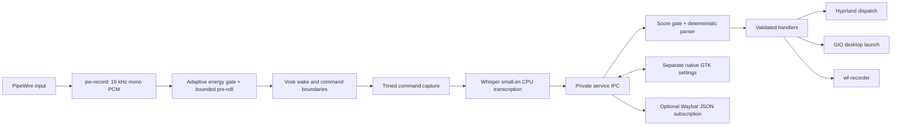

# Architecture and resource ownership

Jarvis has three independent process lifetimes. The stdlib asyncio service owns
configuration, private Unix IPC, app discovery, parsing and action dispatch. It
does not import GTK or any speech inference library. The voice worker owns
Vosk, the resident Whisper small.en transcriber and a `pw-record` child. GTK settings is a separate
process; closing it releases the UI while voice and recorder remain available.
The recorder is a separate established `wf-recorder` process only while needed.

## Activation

The default is `wake_word`, with consent initially false. Before consent, no
microphone/model worker runs. After consent and while unmuted, Vosk and Whisper
remain resident; Vosk gates the stronger model's work. Say “hey Jarvis” or
“Jarvis” followed by one command. A 210 ms quiet period after separate activation prevents the wake-phrase
tail becoming a command. An eight-second default session deadline includes
that settling period. The configurable maximum is fifteen seconds. A command
in the same breath is also supported. Audio must finish within the capture
session; a result may arrive up to 15 seconds after capture ends. Cancellation
and confidence checks still apply.

`paused → idle → listening → processing → idle` is the hands-free path. `idle`
means waiting for activation; the microphone is open. `paused` means voice
capture is closed. `error` exposes microphone/model failure and requires an
explicit retry, avoiding restart churn on a broken input. Recording state is
independent: `idle → recording → stopping → idle`, or `error` with recovery
information. Error recovery does not silently restart capture.

Optional push-to-talk is a bounded listen-once session rather than a key-hold
protocol. It loads a fresh worker on demand and destroys it afterward. Mute
closes the audio stream, clears the decoder, and returns native allocations to
the OS. Worker replacement and mute are serialized, with a post-spawn consent
check so mute wins over an in-flight start. Linux parent-death signals prevent
orphan voice/capture workers after a hard service failure. Recorder shutdown
uses a longer graceful interval for file finalization.

## Bounds and event handling

- Capture is one 960-byte (30 ms) frame at a time plus the finite OS pipe buffer.
  Vosk keeps a 300 ms pre-roll and a 1.2 second hangover. There is no audio
  archive. Continuous speech history resets after ten seconds, including in
  wake mode. Command sessions have a separate wall-clock timeout.
- The service blocks on socket/process events. Voice waits on audio readiness
  with the next deadline as its timeout. No idle status polling or busy loop.
- UI/watch subscriptions use bounded queues of eight latest status events.
  IPC requests/configuration are bounded; worker payload is at most 1 MiB and
  the grammar at most 4096 command phrases plus 2048 application names (extra
  apps are reported as unavailable, never fatal). Slow subscribers cannot grow a queue.
- The recognizer grammar and the parser come from the same tables
  (`Parser.grammar` / `Parser.parse`), so a phrase is listed only if it can be
  both heard and understood.
- Input levels are calculated/displayed only in an explicitly requested,
  fifteen-second test; energy gating still runs for recognition. Status emits
  only on state changes and requested test levels, not on every audio frame.
- PTT releases the model immediately; hands-free retains it until mute/error.
  Only one speech worker and one owned recorder are allowed at a time.
- Whisper's CPU arena is disabled and freed scratch pages are trimmed between
  commands on glibc. Native inference threads sleep between tasks instead of
  spinning. Weights remain loaded; precision and decoding are unchanged.

## Trust boundaries

Speech never becomes shell text. The parser only produces typed intents from
an allowlist. Hyprland workspace IDs are integers 1–10, window focus uses an
address returned by Hyprland, and fullscreen is an idempotent set/unset action.
GIO launches an already discovered desktop-entry path and handles its field
codes/DBus activation. Application aliases map to desktop IDs, not executable
strings. Existing matching windows are focused instead of duplicated; if
several are running, the most recently focused matching window is selected.
Name ambiguity across desktop entries is an error until an alias resolves it.

The Unix socket is 0600 in an owned 0700 directory, and Linux peer credentials
restrict clients to the same user. JSON does not expose an arbitrary command
dispatcher. Same-user processes are trusted to configure/control Jarvis.
The optional developer `MURMUR_DRY_RUN=1` parses actions and returns feedback
without dispatching them; benchmark scripts use it.

The installed systemd unit marks its managed-service context. App/GIO and UI
launches then enter independent transient user scopes, inheriting the graphical
environment while escaping the controller's stop/kill group. Recorder and voice
workers deliberately stay owned by the controller. An actual temporary-unit
test verified that a launched fixture survives parent-service stop; its scope
and processes were then cleaned up. See [result](benchmarks/service-scope-integration.json)
and the primary [systemd-run](https://www.freedesktop.org/software/systemd/man/latest/systemd-run.html)
and [kill-policy](https://www.freedesktop.org/software/systemd/man/latest/systemd.kill.html)
documentation. This optional launch path needs systemd 254+ for explicit argument
expansion control; the test machine uses 262. Manual service execution does not
require a systemd scope runner.

There are no destructive handlers, spoken shell execution, arbitrary executable
aliases, cloud calls, telemetry, transcript history or microphone recordings in
this version. Adding destructive handlers requires explicit confirmation flow
and tests first. Recording microphone audio is a separate deliberate setting;
muting voice control does not alter an already-running recording's audio track.

## Modules

`commands/state` are pure policy. `apps/hyprland/actions/recorder` form the
integration boundary. `vosk_engine/transcriber` implement the default recognition
path and `speech` is the PocketSphinx fallback. `voice`
owns capture/session mechanics, `daemon/client` own transport and process
lifetime, and `ui` is a native client. A different desktop can implement the
desktop query/dispatch adapter without teaching the parser shell commands.
Only Hyprland is implemented and verified here.

The adapter invokes `hyprctl` with structured arguments and parses its JSON
queries. With a Lua Hyprland config (0.55+), dispatches use the Lua
dispatcher form (`hl.dsp.focus`, `hl.dsp.window.move`, `hl.dsp.window.fullscreen`);
the adapter detects `hypr/hyprland.lua`, falls back to the other syntax on
rejection and remembers what works. Installed 0.56.2 exposes the dispatch command; its
[versioned dispatcher registration](https://github.com/hyprwm/Hyprland/blob/v0.56.2/src/managers/KeybindManager.cpp)
retains workspace/move/focus/fullscreen dispatchers through the legacy
translator. The [versioned dispatcher reference](https://wiki.hypr.land/0.54.0/Configuring/Dispatchers/)
documents their argument forms, also checked against the installed release's
[translator implementation](https://github.com/hyprwm/Hyprland/blob/v0.56.2/src/config/legacy/DispatcherTranslator.cpp).
Current Hyprland configuration documentation
uses Lua; Jarvis does not generate or rewrite that configuration. Mutating
window controls still need interactive acceptance on a disposable window,
as detailed in verification.md.
