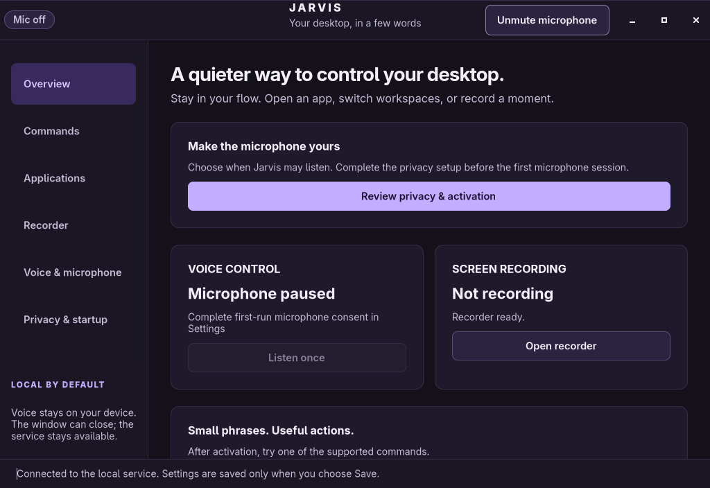

# Native settings window

Jarvis uses Python and GTK4 through PyGObject. There is no browser runtime in the product. The native window is a separate process from the service: closing it releases GTK and its widgets while voice control and recording continue independently. Opening settings never starts the service or accesses a microphone. **Start service** is an explicit action.



The desktop entry opens **Overview**. Its **Open recorder** action opens the Recorder page without starting capture. On every page the header shows the microphone state (Connecting, Mic off, Waiting for wake word, Listening, Working, Needs attention, Offline) beside **Mute microphone**; gold marks the live states. The six pages provide:

- **Overview:** pushed voice/recording status, immediate voice microphone mute, one bounded command session and privacy setup guidance.
- **Commands:** searchable supported actions with examples, and custom phrase mappings to validated built-in commands.
- **Applications:** installed desktop entries, search, and application aliases mapped to desktop IDs. A maximum of 30 results is rendered until search narrows the list.
- **Recorder:** explicit start/stop, saved-file/error feedback, display selection, output folder, audio-source discovery and setup acknowledgement. Frame rate, encoder, quality and optional local sound feedback sit in the collapsed **Sounds & encoding** section. Audio capture requires an explicit source; the current backend supports one source at a time. A combined source must be configured outside Jarvis and explicitly enabled in Recorder before both audio flags can be selected.
- **Voice & microphone:** activation mode (hands-free or push-to-talk) and wake phrase, microphone discovery with an opt-in level test, and recognizer status. Recognition switches, sensitivity, command score and timeout, and the speech energy threshold sit in the collapsed **Fine-tuning** section.
- **Privacy & startup:** first-use consent describing the resident wake recognizer, and enable/disable for the optional installed user service.

## Privacy and microphone lifecycle

The default activation mode is hands-free wake-word detection **after consent**. Before consent, the daemon keeps microphone input closed. Completing the privacy setup acknowledges that the microphone and small wake recognizer remain available while unmuted. Push-to-talk is an optional alternative; it opens a bounded command session. The service validates consent before opening audio even if a different client requests it.

**Mute microphone** closes voice-control input. Recorder microphone audio is a separate deliberate capture setting; stop the recording to end that capture. The input-level test opens input only on request, updates the meter from service events, and sends a stop request when the settings window closes. Command audio and transcripts are not saved by default.

Screen recording requires the user to select a display, configure audio/output/quality, acknowledge capture setup, and save. The acknowledgement cannot bypass compositor or portal permission UI. Opening Recorder never starts recording. Capture may fail with a clear backend/permission error; test a short recording in the actual desktop session before relying on unattended voice capture.

## Accessibility and interaction

All controls are native GTK widgets. Keyboard focus is visible, form controls have accessible labels, text wraps, pages scroll, and relative font sizes follow desktop text scaling. There are no custom animations or frame callbacks. Keyboard shortcuts while the window is open:

| Shortcut | Action |
| --- | --- |
| Ctrl+M | Mute/unmute voice input; first-use consent is still required |
| Ctrl+Space | Listen once; cancel an active command session |
| Ctrl+K | Open command reference |
| Ctrl+W | Close settings |

Save buttons apply the page's settings. Every save fetches the current daemon configuration and merges the edited fields so unrelated settings survive. Saves from this window are serialized. The daemon validates the result and reports failures inline. Enabling startup calls `set_startup`; the optional user service must first be installed using the README procedure. The UI does not edit Hyprland configuration.

## Event and resource model

A blocking private Unix-socket subscription delivers status changes. GTK updates are marshalled onto the main thread with `GLib.idle_add`; IPC, device discovery and settings writes run in worker threads. The window has no periodic status polling, no continuously redrawing meter, and no voice model imports. The sole bounded startup retry waits at most 3 seconds for an explicitly launched service socket, then uses the normal IPC timeout for its first request. Input test updates occur only while the test is active.

Application discovery and command references load when the window opens or reconnects. When the voice worker reports readiness, its pushed `unsupported_phrases` list updates application speech-support badges and a short dictionary-limitation notice. Names outside the local English dictionary need a common-word alias; for example, Stremio can use “stream video”. If that alias is supported, the app row shows the phrase to say while still explaining that the direct name is unavailable. Loading states do not establish dictionary support, and repeated level/status events do not rebuild the app list when exclusions and app mappings are unchanged. This requires no application polling. Microphones/displays can be refreshed explicitly. Device and model availability is reported by the service; missing dependencies do not produce fabricated status.

## Verification

On 20 October 2026, GTK 4.24.1/PyGObject construction succeeded for all six pages using the temporary GTK Broadway test display. A live service in an isolated temporary configuration/socket, with privacy consent disabled, verified:

- successful status/configuration/command/application/device IPC (6 command groups, 85 installed desktop entries and 3 input-device entries on this machine);
- wake-word selection as the default, with listen and microphone-test controls disabled before consent;
- voice and recorder settings round trips;
- adding and removing a command shortcut, preserving unrelated configuration;
- command search filtering and page construction;
- a second `murmur ui --page recording` request routing an existing window to Recorder in an isolated session bus;
- microphone remaining muted and `microphone_open=false` throughout the checks.

A final native-display construction smoke, with IPC disabled and no window presented, also verified the sound-feedback save field and combined-source acknowledgement gating both audio flags. No microphone or recorder calls were made. A further native widget check with explicit status fixtures verified that model-loading events leave speech support unconfirmed, readiness repairs initially incorrect app flags, dictionary limitations and the Stremio alias hint appear, and repeated level-only events do not rebuild application widgets.

The PNG above is a real GTK snapshot of that consent-disabled test service. Broadway was a test transport only; it is not a shipped UI dependency. A later browser-connected Broadway benchmark aborted with GTK 4.24.1’s `append_node_ops: node == reused_node` assertion; that run was rejected. Native construction and the static snapshot above passed. Broadway is a test-backend limitation and cannot establish Wayland rendering performance. Real-session keyboard/screen-reader behavior, fractional scaling, and microphone/recording interactions still need interactive testing under Hyprland. The application's main performance report separates settings-window cost from service and recording cost.

For a construction smoke check without accessing audio, start a temporary `gtk4-broadwayd :18` in a test session, then run:

```sh
GDK_BACKEND=broadway BROADWAY_DISPLAY=:18 PYTHONPATH=src python - <<'PY'
from gi.repository import GLib
from murmur.ui import Gtk, JarvisWindow
assert Gtk.init_check()
app = Gtk.Application(application_id="org.murmur.ConstructionCheck")
app.register(None)
window = JarvisWindow(app)
assert window.stack.get_pages().get_n_items() == 6
window.close()
print("Six native GTK pages constructed")
PY
```

Official API references used: [Gtk.Application](https://docs.gtk.org/gtk4/class.Application.html), [Gtk.DropDown](https://docs.gtk.org/gtk4/class.DropDown.html), and [GLib.idle_add](https://docs.gtk.org/glib/func.idle_add.html). Install GTK4 and PyGObject using your distribution packages. The UI prints setup guidance when GTK or a graphical display is unavailable; the service and CLI remain separate.
